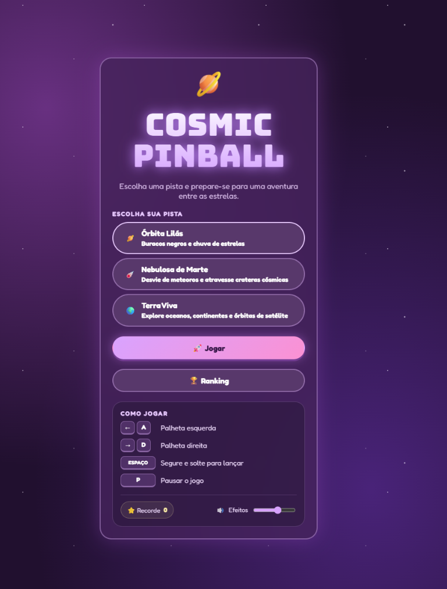
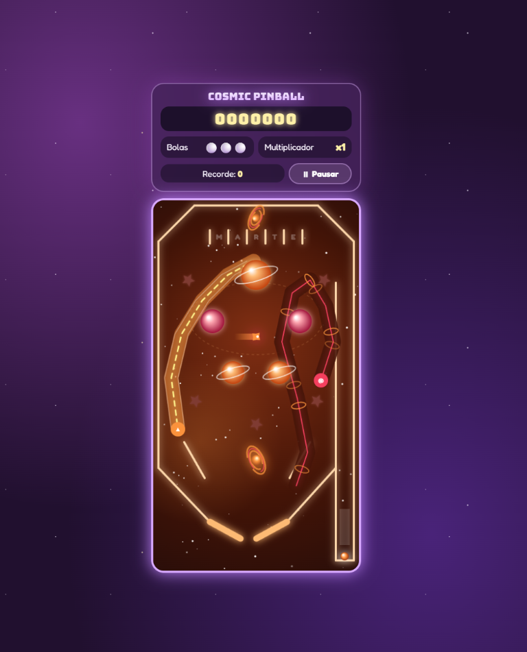
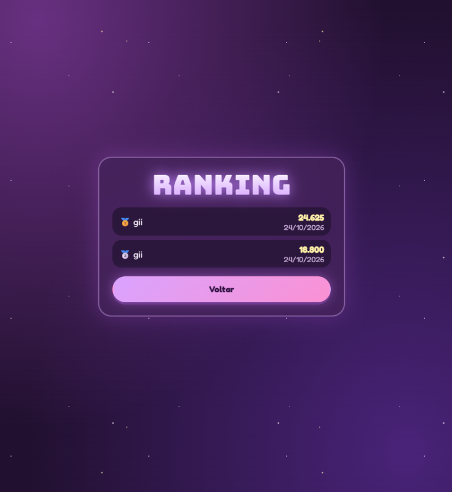

# Cosmic Pinball

Pinball arcade com tema espacial, feito para jogar no navegador em desktop e
celular. Escolha uma pista, acione as palhetas e tente fazer a maior pontuação.

## Jogue online

Acesse [gk-pinball.netlify.app](https://gk-pinball.netlify.app/) para jogar
diretamente no navegador do celular ou computador.

## Capturas de tela

| Tela inicial                                                                                                                | Partida — Nebulosa de Marte                                                                             | Ranking                                                                                 |
| --------------------------------------------------------------------------------------------------------------------------- | ------------------------------------------------------------------------------------------------------- | --------------------------------------------------------------------------------------- |
|  |  |  |

## Pistas

- **Órbita Lilás** — cometas, estrelas e buracos negros.
- **Nebulosa de Marte** — meteoros, crateras e rampas marcianas.
- **Terra Viva** — oceanos, continentes, correntes e satélite.

## Como jogar

| Ação                     | Teclado                 | Celular                     |
| ------------------------ | ----------------------- | --------------------------- |
| Acionar palheta esquerda | `←` ou `A`              | Toque e segure **Esquerda** |
| Acionar palheta direita  | `→` ou `D`              | Toque e segure **Direita**  |
| Carregar e lançar a bola | Segure e solte `Espaço` | Segure e solte **Lançar**   |
| Pausar                   | `P` ou `Esc`            | Botão **Pausar**            |

O layout e os controles se adaptam à orientação e ao espaço disponível na tela.
O jogo inclui efeitos sonoros ajustáveis, sem música de fundo.

## Tecnologias

- Angular 21 (standalone)
- TypeScript 5.9
- HTML e CSS
- Canvas 2D para renderização e física do pinball
- Vitest para testes
- `localStorage` para guardar o ranking no navegador

## Requisitos

- Node.js 20.19+, 22.12+ ou 24+
- npm

## Desenvolvimento local

Na raiz do repositório:

```sh
npm install
npm run dev
```

Abra [http://localhost:4200](http://localhost:4200).

## Testes e build

```sh
npm test
npm run build
```

O build de produção é gerado em `apps/web/dist/cosmic-pinball/browser`.

## Estrutura do projeto

```text
apps/
  web/
    src/app/          # Interface, telas e controles
    src/app/game/     # Motor, pistas, física e ranking
docs/
  images/             # Capturas de tela usadas neste README
```
